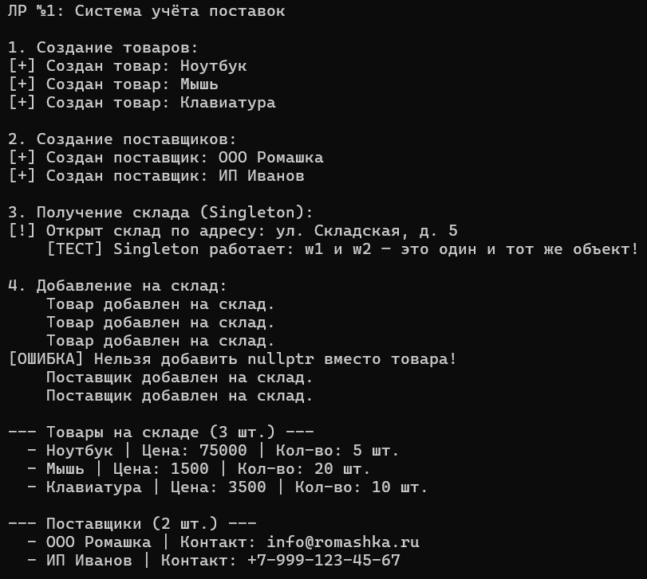
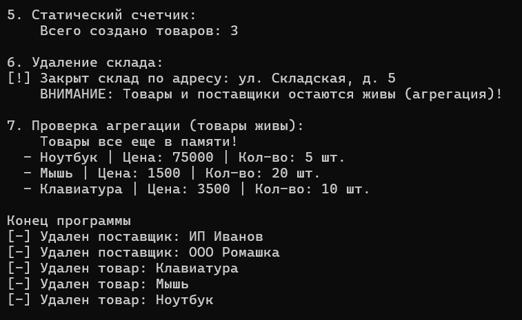

# Лабораторная работа №1. Отношения между классами: композиция, агрегация, ассоциация

**Студент:** Гуртуев Идар Алиевич

**Группа:** ПИЖ-б-о-25-1

**Вариант:** 7 — Система учёта поставок

**Технология:** C++

**Репозиторий:** [ССЫЛКА_НА_GITHUB_БУДЕТ_ЗДЕСЬ]

---

## 1. Цель работы

Освоить проектирование отношений между классами (композиция, агрегация, ассоциация). Научиться использовать статические поля и методы для подсчёта объектов. Реализовать паттерн «Одиночка» (Singleton). Получить навыки управления памятью при разных типах отношений.

---

## 2. Теоретическое обоснование

**Композиция** — отношение «часть-целое», при котором часть не может существовать без целого. В C++ реализуется через поля-объекты.

**Агрегация** — отношение «часть-целое», при котором часть может существовать независимо от целого. В C++ реализуется через указатели или ссылки.

**Статическое поле** — принадлежит всему классу, а не отдельному объекту. Одно на всех. Используется для счётчиков, реестров, общих настроек.

**Singleton (Одиночка)** — паттерн, гарантирующий, что у класса есть только один экземпляр. Реализуется через приватный конструктор, статический указатель и статический метод `getInstance()`.

---

## 3. Постановка задачи (Вариант 7)

**Система учёта поставок:**
- `Warehouse` (склад) — **Singleton**.
- `Product` (товар) — **агрегация** (товар живёт отдельно от склада).
- `Supplier` (поставщик) — **агрегация** (поставщик живёт отдельно от склада).
- **Статическое поле** в `Product` — счётчик всех созданных товаров.

**Требуется продемонстрировать:**
1. Работу Singleton (два вызова `getInstance()` возвращают один и тот же объект).
2. Работу агрегации (при удалении склада товары остаются живы).
3. Работу статического счётчика.
4. Защиту от `nullptr`.

---

## 4. Ключевые фрагменты кода

### 4.1. Singleton в классе `Warehouse`

```cpp
class Warehouse {
private:
    static Warehouse* instance;  // Единственный экземпляр
    Warehouse(string addr) : address(addr) {}  // Приватный конструктор

public:
    Warehouse(const Warehouse&) = delete;            // Запрет копирования
    Warehouse& operator=(const Warehouse&) = delete;

    static Warehouse* getInstance(string addr = "...") {
        if (instance == nullptr) {
            instance = new Warehouse(addr);  // Создаём, только если нет
        }
        return instance;  // Всегда один и тот же объект
    }
};

Warehouse* Warehouse::instance = nullptr;
```

**Что это даёт:** нельзя создать второй склад. `getInstance()` всегда возвращает один и тот же объект.

### 4.2. Агрегация: `Warehouse` хранит указатели

```cpp
class Warehouse {
private:
    vector<Product*> products;    // Указатели — агрегация
    vector<Supplier*> suppliers;  // Указатели — агрегация
};
```

**Что это даёт:** при удалении склада товары и поставщики **не удаляются** — они живут отдельно.

### 4.3. Статический счётчик в классе `Product`

```cpp
class Product {
private:
    static int productCount;  // Одно на весь класс

public:
    Product(...) { productCount++; }   // Увеличиваем при создании
    ~Product() { productCount--; }     // Уменьшаем при удалении

    static int getCount() { return productCount; }  // Статический метод
};

int Product::productCount = 0;  // Обязательное определение
```

**Что это даёт:** можно узнать количество товаров, не создавая объект: `Product::getCount()`.

### 4.4. Защита от `nullptr`

```cpp
void addProduct(Product* p) {
    if (p == nullptr) {
        cout << "[ОШИБКА] Нельзя добавить nullptr вместо товара!" << endl;
        return;
    }
    products.push_back(p);
}
```

**Что это даёт:** программа не упадёт при попытке добавить `nullptr`.

---

## 5. Результаты работы

### 5.1. Первая часть вывода

Демонстрация создания товаров, поставщиков, работы Singleton и добавления на склад.

**Рисунок 1 — Создание объектов и Singleton**



### 5.2. Вторая часть вывода

Демонстрация статического счётчика, удаления склада и проверки агрегации (товары остаются живы).

**Рисунок 2 — Статика и агрегация**



---

## 6. Ответы на контрольные вопросы

### 1. Что такое композиция? Приведите пример.

Композиция — отношение «часть-целое», при котором часть не может существовать без целого. Пример: `Дом` и `Комнаты`. При удалении дома комнаты удаляются автоматически.

### 2. Что такое агрегация? Чем она отличается от композиции?

Агрегация — отношение «часть-целое», при котором часть может существовать независимо от целого. Пример: `Библиотека` и `Книги`. При удалении библиотеки книги остаются.

**Отличие:** при композиции часть умирает вместе с целым; при агрегации — нет.

### 3. Как реализовать композицию в C++?

Через **поле-объект**:
```cpp
class House {
    Room livingRoom;  // Композиция
};
```

### 4. Как реализовать агрегацию в C++?

Через **указатели или ссылки**:
```cpp
class Library {
    vector<Book*> books;  // Агрегация
};
```

### 5. В чём разница между временем жизни частей при композиции и агрегации?

- **Композиция:** время жизни части **ограничено** временем жизни целого.
- **Агрегация:** часть может жить **дольше** целого.

### 6. Что такое статическое поле класса?

Поле, принадлежащее **всему классу**, а не отдельному объекту. Существует в **одном экземпляре** для всех объектов класса.

### 7. Как объявить и определить статическое поле?

Объявление — внутри класса (`static int count;`).  
Определение — **вне класса** (`int ClassName::count = 0;`).  
Хранится в **статической области памяти**, не в объекте.

### 8. Что такое статический метод? Можно ли из него обратиться к нестатическим полям?

Метод, который можно вызывать **без создания объекта**.  
**Нельзя** обращаться к нестатическим полям, потому что у статического метода нет `this`.

### 9. Для чего используются статические счётчики объектов?

Для подсчёта количества созданных объектов, отслеживания активных экземпляров, ведения статистики.

### 10. Что такое паттерн «Одиночка» (Singleton)? Для чего он нужен?

Паттерн, гарантирующий, что у класса **только один экземпляр**. Используется для: подключения к БД, настроек приложения, логгеров, кэша.

### 11. Как запретить создание копий объекта?

Через `= delete`:
```cpp
ClassName(const ClassName&) = delete;
ClassName& operator=(const ClassName&) = delete;
```

### 12. В каком порядке вызываются конструкторы и деструкторы при композиции?

**Конструкторы:** сначала части, потом целое (в порядке объявления полей).  
**Деструкторы:** сначала целое, потом части (в обратном порядке).

### 13. Можно ли изменить статическое поле из обычного метода?

Да. Обычный метод имеет доступ к статическим полям класса.

### 14. Почему статические поля нужно определять вне класса?

Потому что объявление внутри класса — это только **декларация**. Для выделения памяти нужно **определение** вне класса. Без него будет ошибка линковки.

### 15. В каких случаях стоит использовать композицию, а в каких — агрегацию?

- **Композиция:** когда часть **не имеет смысла** без целого (Комната без Дома, Двигатель без Машины).
- **Агрегация:** когда часть может **существовать отдельно** (Книга без Библиотеки, Студент без Группы).

---

## 7. Вывод

В ходе лабораторной работы освоены три типа отношений между классами: композиция, агрегация и ассоциация. Реализована **агрегация** между `Warehouse` и классами `Product`/`Supplier`: товары и поставщики создаются независимо и остаются живы после удаления склада.

Реализован паттерн **Singleton** для класса `Warehouse`: невозможно создать второй склад, а `getInstance()` всегда возвращает единственный экземпляр.

Освоены **статические поля и методы**: `Product::productCount` считает количество созданных товаров, `Product::getCount()` возвращает это значение без создания объекта.

Добавлена **защита от `nullptr`** в методах `addProduct` и `addSupplier`, что предотвращает падение программы.

В результате получены навыки:
- Проектирования связей между классами.
- Управления памятью при агрегации.
- Использования статических членов класса.
- Реализации паттерна Singleton.

---

## 8. Список использованных источников

1. Документация C++ (cppreference): https://en.cppreference.com/
2. Паттерн Singleton: https://refactoring.guru/ru/design-patterns/singleton
3. Статические члены класса: https://metanit.com/cpp/tutorial/5.12.php