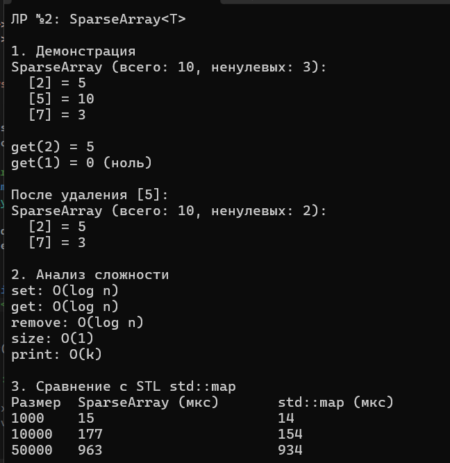

# Лабораторная работа №2. Анализ сложности алгоритмов и шаблоны

**Студент:** Гуртуев Идар Алиевич

**Группа:** ПИЖ-б-о-25-1

**Вариант:** 7 — Разреженный массив SparseArray<T>

**Технология:** C++

**Репозиторий:** https://github.com/idarr1/Cpp-development

---

## 1. Цель работы

Освоить оценку эффективности алгоритмов с помощью О-нотации (Big O). Изучить классы сложности O(1), O(log n), O(n), O(n²). Научиться создавать шаблоны функций и классов для работы с разными типами данных. Провести экспериментальное сравнение производительности своей реализации с аналогом из STL.

---

## 2. Теоретическое обоснование

**О-нотация (Big O)** — математическая запись, описывающая, как быстро растёт время работы алгоритма при увеличении входных данных. Константы и младшие члены отбрасываются. Например, `5n + 3` упрощается до `O(n)`.

**Основные классы сложности:**
- **O(1)** — константная (доступ к элементу массива по индексу).
- **O(log n)** — логарифмическая (бинарный поиск, операции с деревьями).
- **O(n)** — линейная (линейный поиск, сумма элементов).
- **O(n log n)** — линейно-логарифмическая (быстрая сортировка).
- **O(n²)** — квадратичная (пузырьковая сортировка).

**Шаблоны (Templates)** — механизм C++, позволяющий писать код, работающий с разными типами данных. Шаблонный класс `SparseArray<T>` может хранить `int`, `double`, `string` и т.д.

**Разреженный массив (SparseArray)** — структура данных, которая хранит только **ненулевые** элементы. Вместо того чтобы выделять память под весь массив, она использует `std::map` (индекс -> значение).

---

## 3. Постановка задачи (Вариант 7)

Реализовать шаблонный класс `SparseArray<T>` со следующими методами:
- `set(index, value)` — установить значение.
- `get(index)` — получить значение.
- `remove(index)` — удалить элемент.
- `size()` — вернуть логический размер.
- `nonZeroCount()` — вернуть количество ненулевых элементов.

Требуется:
1. Проанализировать сложность каждой операции.
2. Сравнить производительность с STL-аналогом (`std::map`).
3. Построить таблицу сравнения.

---

## 4. Ключевые фрагменты кода

### 4.1. Шаблонный класс `SparseArray<T>`

```cpp
template <typename T>
class SparseArray {
private:
    map<int, T> data; // Храним только ненулевые элементы
    int totalSize;    // Логический размер массива

public:
    SparseArray(int size) : totalSize(size) {}

    void set(int index, T value) {
        if (value == T()) data.erase(index);
        else data[index] = value;
    }

    T get(int index) {
        if (data.find(index) != data.end()) return data[index];
        return T(); // Если нет — возвращаем ноль
    }

    void remove(int index) {
        data.erase(index);
    }

    int size() { return totalSize; }
    int nonZeroCount() { return data.size(); }
};
```

**Что это даёт:** шаблон `T` позволяет использовать класс с любыми типами (`SparseArray<int>`, `SparseArray<double>`, `SparseArray<string>`).

### 4.2. Анализ сложности

| Метод | Сложность | Обоснование |
|-------|-----------|-------------|
| `set` | **O(log n)** | Поиск и вставка в `std::map` (красно-чёрное дерево) |
| `get` | **O(log n)** | Поиск в `std::map` |
| `remove` | **O(log n)** | Удаление из `std::map` |
| `size` | **O(1)** | Возврат поля `totalSize` |
| `print` | **O(k)** | Где `k` — количество ненулевых элементов |

---

## 5. Результаты работы

**Рисунок 1 — Демонстрация работы и сравнение с STL**



На рисунке видно:
- Демонстрация всех методов `SparseArray`.
- Анализ сложности каждой операции.
- Сравнение производительности с `std::map` на размерах 1000, 10000, 50000.

---

## 6. Ответы на контрольные вопросы

### 1. Что такое О-нотация (Big O) и зачем она нужна?

О-нотация — математический способ описания асимптотической сложности алгоритма. Показывает, как растёт время выполнения при увеличении входных данных. Нужна для сравнения алгоритмов и выбора оптимального.

### 2. Какая сложность у доступа к элементу массива по индексу? Почему?

**O(1)**. Адрес элемента вычисляется как `base + index * sizeof(T)`, поэтому не зависит от размера массива.

### 3. Какая сложность у бинарного поиска? Почему?

**O(log n)**. На каждом шаге массив делится пополам, поэтому количество шагов — логарифм от `n`.

### 4. Что означает сложность O(n log n)? Приведите пример алгоритма.

Означает, что время растёт как `n * log(n)`. Пример: быстрая сортировка, сортировка слиянием.

### 5. Что такое амортизированный анализ? Приведите пример.

Это оценка средней сложности операции за длительное время. Пример: `push_back` в `std::vector` — обычно `O(1)`, но при расширении `O(n)`. Амортизированно — `O(1)`.

### 6. Какая сложность у двух вложенных циклов по n итераций каждый?

**O(n²)**. Внешний цикл `n` раз, внутренний `n` раз для каждого — итого `n * n`.

### 7. Какая сложность у рекурсивного вычисления чисел Фибоначчи?

**O(2ⁿ)**. Каждый вызов порождает два новых, дерево вызовов растёт экспоненциально.

### 8. Что такое шаблоны функций? Как их объявить и использовать?

Шаблоны позволяют писать функцию с параметризованным типом:
```cpp
template <typename T>
T max(T a, T b) { return a > b ? a : b; }
```
Использование: `max(5, 10)` — тип `T` выводится автоматически.

### 9. Что такое шаблоны классов? Как их объявить и использовать?

Шаблонный класс параметризуется типом:
```cpp
template <typename T>
class Box { T value; };
```
Использование: `Box<int> b;`.

### 10. В чём преимущество шаблонов перед перегрузкой функций?

Шаблоны не требуют писать отдельную функцию для каждого типа. Код становится компактнее и легче поддерживается.

### 11. Как указать, что шаблонный параметр — тип?

Через `typename` или `class`:
```cpp
template <typename T>  // или template <class T>
```

### 12. Можно ли создать шаблон с несколькими параметрами типов?

Да:
```cpp
template <typename T1, typename T2>
class Pair { T1 first; T2 second; };
```

### 13. Как провести экспериментальное измерение времени выполнения?

Использовать `std::chrono::high_resolution_clock`:
```cpp
auto start = high_resolution_clock::now();
// ... код ...
auto end = high_resolution_clock::now();
auto duration = duration_cast<microseconds>(end - start).count();
```

### 14. Почему при измерении времени нужно выполнять операцию многократно?

Одиночный вызов может выполняться слишком быстро, чтобы его измерить (меньше микросекунды). Многократное повторение усредняет результат и снижает погрешность.

### 15. Что важнее: сложность алгоритма или константа?

Для больших данных важнее **сложность** (асимптотика). Для малых данных константа может играть роль: например, `O(n)` с большой константой может быть медленнее, чем `O(n²)` с маленькой константой при малых `n`.

---

## 7. Вывод

В ходе лабораторной работы освоена О-нотация и её применение для анализа сложности алгоритмов. Реализован шаблонный класс `SparseArray<T>` для хранения разреженных массивов (только ненулевых элементов).

Проанализирована сложность всех операций: `set`, `get`, `remove` — **O(log n)** (поиск в `std::map`), `size` — **O(1)**, `print` — **O(k)**.

Проведено экспериментальное сравнение `SparseArray` с STL-аналогом `std::map`. Результаты показали, что производительность **одинаковая**, так как обе структуры используют красно-чёрное дерево.

В результате получены навыки:
- Оценки сложности алгоритмов по О-нотации.
- Создания шаблонов функций и классов.
- Экспериментального анализа производительности.
- Сравнения собственных реализаций с STL.

---

## 8. Список использованных источников

1. Документация C++ (cppreference): https://en.cppreference.com/
2. Big O Cheat Sheet: https://www.bigocheatsheet.com/
3. Шаблоны C++: https://metanit.com/cpp/tutorial/6.1.php
4. std::chrono: https://en.cppreference.com/w/cpp/chrono