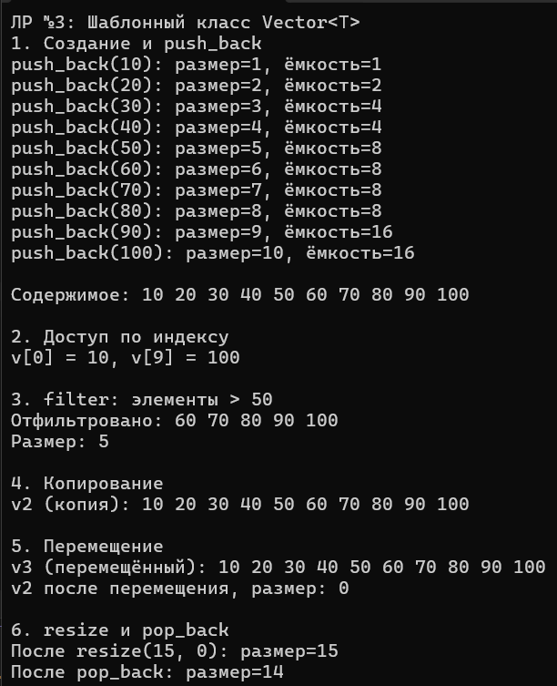

# Лабораторная работа №3. Шаблонный класс Vector<T>

**Студент:** Гуртуев Идар Алиевич

**Группа:** ПИЖ-б-о-25-1

**Вариант:** 7 (Продвинутый уровень) — метод `filter(predicate)`

**Технология:** C++

**Репозиторий:** https://github.com/idarr1/Cpp-development

---

## 1. Цель работы

Реализовать шаблонный класс `Vector<T>` — аналог `std::vector` — с нуля. Освоить управление динамической памятью. Закрепить «правило трёх» и освоить «правило пяти». Реализовать итераторы. Провести амортизированный анализ `push_back`.

---

## 2. Теоретическое обоснование

**Динамический массив** — структура данных, которая хранит элементы в куче и может менять размер во время работы.

- **size** — текущее количество элементов.
- **capacity** — выделенная ёмкость.

**Правило трёх:** деструктор + конструктор копирования + оператор присваивания копированием.
**Правило пяти:** + конструктор перемещения + оператор присваивания перемещением.

**Амортизированный анализ `push_back`:** удвоение ёмкости даёт в среднем **O(1)**.

---

## 3. Постановка задачи (Вариант 7)

Реализовать шаблонный класс `Vector<T>`:
- Конструкторы: по умолчанию, с параметром (размер).
- Методы: `push_back`, `pop_back`, `resize`, `capacity`.
- **Доп. функциональность:** `filter(predicate)`.
- Правило пяти.
- Итераторы (`begin`, `end`).
- Обработка исключений.

---

## 4. Ключевые фрагменты кода

### 4.1. Класс `Vector<T>`

```cpp
template <typename T>
class Vector {
private:
    T* data;    // Динамический массив
    int sz;     // Размер
    int cap;    // Ёмкость
public:
    Vector() : data(nullptr), sz(0), cap(0) {}
    explicit Vector(int n) : sz(n), cap(n) { /* ... */ }
};
```

**Что делает:** приватные поля защищают данные от прямого изменения извне.

### 4.2. Конструктор копирования

```cpp
Vector(const Vector& other) : sz(other.sz), cap(other.cap) {
    data = new T[cap];
    for (int i = 0; i < sz; i++) data[i] = other.data[i];
}
```

**Зачем:** глубокое копирование — у каждого объекта своя память (без двойного удаления).

### 4.3. Конструктор перемещения

```cpp
Vector(Vector&& other) noexcept : data(other.data), sz(other.sz), cap(other.cap) {
    other.data = nullptr;
    other.sz = 0;
    other.cap = 0;
}
```

**Зачем:** забирает ресурсы у `other`, работает за O(1), `noexcept` для безопасности.

### 4.4. `push_back` (амортизированно O(1))

```cpp
void push_back(const T& value) {
    if (sz >= cap) {
        int newCap = cap == 0 ? 1 : cap * 2;
        reserve(newCap);
    }
    data[sz++] = value;
}
```

**Зачем:** удвоение ёмкости даёт в среднем **O(1)** (копирование редко).

### 4.5. Итераторы

```cpp
T* begin() { return data; }
T* end() { return data + sz; }
```

**Зачем:** работают с `range-based for` и STL-алгоритмами.

### 4.6. `filter` (Вариант 7)

```cpp
Vector<T> filter(function<bool(const T&)> predicate) const {
    Vector<T> result;
    for (int i = 0; i < sz; i++) {
        if (predicate(data[i])) result.push_back(data[i]);
    }
    return result;
}
```

**Зачем:** возвращает новый вектор с элементами, прошедшими условие (например, `x > 50`).

---

## 5. Анализ сложности

| Операция | Сложность |
|----------|-----------|
| `operator[]` | **O(1)** |
| `push_back` | **O(1)** амортизированно |
| `pop_back` | **O(1)** |
| `resize` | **O(n)** |
| `filter` | **O(n)** |
| `size`, `capacity` | **O(1)** |

---

## 6. Результаты работы

**Рисунок 1 — Демонстрация работы `Vector<T>`**



---

## 7. Ответы на контрольные вопросы

### 1. Почему динамический массив называется «динамическим»?
Размер меняется во время работы. Память выделяется в куче (`new`).

### 2. Что такое ёмкость и чем она отличается от размера?
`size` — сколько сейчас. `capacity` — сколько влезет без расширения.

### 3. Почему при расширении ёмкость удваивается, а не увеличивается на 1?
Удвоение даёт **O(1)** амортизированно. Иначе было бы **O(n²)**.

### 4. Амортизированная сложность `push_back`?
**O(1)** — редкие расширения компенсируются.

### 5. Что такое «правило трёх»?
Деструктор + конструктор копирования + оператор присваивания копированием.

### 6. Что такое «правило пяти»?
Правило трёх + конструктор перемещения + оператор присваивания перемещением.

### 7. Конструктор копирования vs оператор присваивания?
Конструктор — создаёт **новый** объект. Оператор — заменяет содержимое **существующего**.

### 8. Зачем `if (this != &other)`?
Защита от самоприсваивания (`v = v`). Иначе удалим свои данные.

### 9. Что такое итератор?
Указатель на элемент контейнера. Простейший итератор — `T*`.

### 10. Зачем `begin()` и `end()`?
`begin()` — на первый, `end()` — **на элемент после последнего**. Нужны для `range-based for`.

### 11. Как реализовать `range-based for` для своего контейнера?
Реализовать методы `begin()` и `end()`, возвращающие указатели.

### 12. Глубокое копирование vs поверхностное?
Глубокое — своя память (безопасно). Поверхностное — общий указатель (double free).

### 13. Что такое семантика перемещения?
Забрать ресурсы у временного объекта без копирования. Ускоряет работу.

### 14. Почему конструктор перемещения `noexcept`?
Гарантирует отсутствие исключений — позволяет `std::vector` безопасно перемещать.

### 15. Как освобождать память в деструкторе?
`delete[] data;` — именно `delete[]`, потому что массив.

---

## 8. Вывод

Реализован шаблонный класс `Vector<T>` с правилом трёх/пяти, итераторами и методом `filter`. Освоено управление динамической памятью, амортизированный анализ `push_back` (**O(1)**). Для варианта 7 добавлена фильтрация по условию.

---

## 9. Список использованных источников

1. cppreference: https://en.cppreference.com/
2. Правило трёх/пяти: https://en.cppreference.com/w/cpp/language/rule_of_three
3. std::vector: https://en.cppreference.com/w/cpp/container/vector