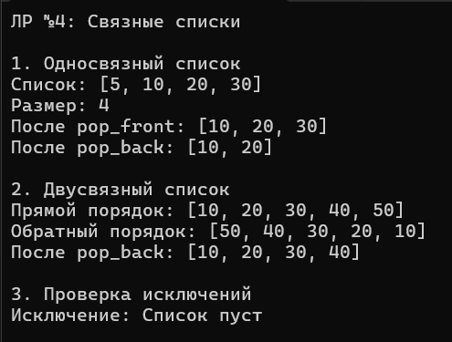

# Лабораторная работа №4. Односвязный и двусвязный списки

**Студент:** Гуртуев Идар Алиевич

**Группа:** ПИЖ-б-о-25-1

**Вариант:** 7 (Продвинутый уровень) — обработка исключений

**Технология:** C++

**Репозиторий:** https://github.com/idarr1/Cpp-development

---

## 1. Цель работы

Реализовать шаблонные классы односвязного (`SinglyLinkedList`) и двусвязного (`DoublyLinkedList`) списков. Освоить операции вставки, удаления, поиска и обхода. Научиться правильно управлять динамической памятью и реализовать обработку исключений (вариант 7).

---

## 2. Теоретическое обоснование

**Связный список** — структура данных, где элементы (узлы) хранятся в памяти не непрерывно. Каждый узел содержит данные и указатель(и) на следующий (и/или предыдущий) узел.

- **Односвязный список:** узел хранит `data` и `next`. Позволяет ходить только вперёд.
- **Двусвязный список:** узел хранит `data`, `prev` и `next`. Позволяет ходить в обе стороны.

**Ключевые понятия:**
- **head** — указатель на первый узел.
- **tail** — указатель на последний узел.

---

## 3. Постановка задачи (Вариант 7)

Реализовать **оба класса** списков с полной функциональностью:
1. **`SinglyLinkedList`:** `push_front`, `push_back`, `pop_front`, `pop_back`, `find`, `remove`, `print`.
2. **`DoublyLinkedList`:** `push_front`, `push_back`, `pop_front`, `pop_back`, `find`, `print`, `printReverse`.
3. **Обработка исключений:** при попытке удаления из пустого списка выбрасывать `std::underflow_error`.

---

## 4. Ключевые фрагменты кода

### 4.1. Односвязный список: вставка в конец (O(1))

```cpp
void push_back(const T& value) {
    Node* newNode = new Node(value);
    if (head == nullptr) {
        head = tail = newNode; // Первый элемент
    } else {
        tail->next = newNode;  // Прикрепляем к хвосту
        tail = newNode;        // Обновляем хвост
    }
    count++;
}
```
*Благодаря указателю `tail` вставка в конец выполняется за O(1).*

### 4.2. Односвязный список: удаление из конца (O(n))

```cpp
void pop_back() {
    if (head == nullptr) throw underflow_error("Список пуст");
    if (head == tail) {
        delete head;
        head = tail = nullptr;
    } else {
        Node* current = head;
        while (current->next != tail) { // Идем до предпоследнего
            current = current->next;
        }
        delete tail;
        tail = current;
        tail->next = nullptr;
    }
    count--;
}
```
*Приходится искать предпоследний узел, поэтому сложность O(n).*

### 4.3. Двусвязный список: удаление из конца (O(1))

```cpp
void pop_back() {
    if (tail == nullptr) throw underflow_error("Список пуст");
    DNode* temp = tail;
    tail = tail->prev; // Просто берем предыдущий
    if (tail != nullptr) tail->next = nullptr;
    else head = nullptr;
    delete temp;
    count--;
}
```
*Главное преимущество двусвязного списка: удаление из конца за O(1).*

### 4.4. Обработка исключений (Вариант 7)

```cpp
void pop_front() {
    if (head == nullptr) throw underflow_error("Список пуст");
    // ... удаление ...
}
```
*Вместо падения программы мы выбрасываем исключение, которое можно перехватить в `main`.*

---

## 5. Анализ сложности операций

| Операция | Односвязный | Двусвязный |
|----------|-------------|------------|
| `push_front` | **O(1)** | **O(1)** |
| `push_back` | **O(1)** (с tail) | **O(1)** |
| `pop_front` | **O(1)** | **O(1)** |
| `pop_back` | **O(n)** | **O(1)** |
| `find` | **O(n)** | **O(n)** |
| `print` | **O(n)** | **O(n)** |
| `printReverse` | — | **O(n)** |

---

## 6. Результаты работы

**Рисунок 1 — Демонстрация работы списков и обработки исключений**



На скриншоте видно:
- Работу `SinglyLinkedList` (вставка, удаление, вывод).
- Работу `DoublyLinkedList` (прямой и обратный обход).
- Перехват исключения при попытке удаления из пустого списка.

---

## 7. Ответы на контрольные вопросы

### 1. Чем связный список отличается от динамического массива?
В массиве элементы лежат непрерывно (доступ по индексу O(1)). В списке элементы разбросаны, связаны указателями (доступ по индексу O(n), но вставка/удаление в начале O(1)).

### 2. Какие операции в односвязном списке выполняются за O(1)?
`push_front`, `push_back` (если есть `tail`), `pop_front`.

### 3. Почему удаление из конца односвязного списка требует O(n)?
Нужно найти предпоследний узел, чтобы обновить `tail`. Для этого нужно пройти от `head` до конца (O(n)).

### 4. Какие преимущества даёт хранение указателя tail в односвязном списке?
Позволяет делать `push_back` за O(1), а не за O(n).

### 5. Чем двусвязный список отличается от односвязного?
Узел двусвязного хранит указатель и на следующий, и на предыдущий элементы. Позволяет ходить в обе стороны и удалять из конца за O(1).

### 6. Какие операции в двусвязном списке выполняются быстрее, чем в односвязном?
`pop_back` (O(1) вместо O(n)).

### 7. Что такое «голова» (head) и «хвост» (tail) списка?
`head` — указатель на первый узел. `tail` — на последний.

### 8. Как удалить узел из середины односвязного списка?
Найти узел перед удаляемым (O(n)), сохранить указатель на следующий (`current->next = toDelete->next`), удалить узел.

### 9. Как удалить узел из середины двусвязного списка? Почему это проще?
Проще, потому что у узла есть `prev` (не нужно искать предшественника): `node->prev->next = node->next; node->next->prev = node->prev;`.

### 10. Что произойдёт, если забыть обновить tail при удалении?
Список будет «сломан» — `tail` будет указывать на удаленный узел (висячий указатель). При добавлении новых элементов возникнет ошибка доступа к памяти.

### 11. Как реализовать реверс односвязного списка?
Идти по списку, меняя указатели `next` на `prev` (сохраняя текущий `next` во временную переменную). Или использовать рекурсию.

### 12. Как обнаружить цикл в связном списке?
«Алгоритм черепахи и зайца» (Флойда): два указателя — медленный (шаг 1) и быстрый (шаг 2). Если они встретятся — есть цикл.

### 13. В каких случаях стоит использовать список вместо массива?
При частых вставках и удалениях в начале/середине, когда размер заранее неизвестен.

### 14. Какая дополнительная память требуется для каждого узла списка?
Односвязный — указатель `next` (8 байт на 64-битной системе). Двусвязный — `prev` и `next` (16 байт).

### 15. Почему доступ по индексу в списке имеет сложность O(n)?
Потому что элементы не лежат подряд в памяти. Чтобы найти i-й элемент, нужно пройти по указателям от `head` до него.

---

## 8. Вывод

В ходе лабораторной работы реализованы шаблонные классы односвязного и двусвязного списков. Освоены операции вставки, удаления, поиска и обхода. Реализовано управление динамической памятью (деструкторы очищают список, утечек нет).

Для варианта 7 добавлена обработка исключений (`std::underflow_error` при попытке удаления из пустого списка). Проведен анализ сложности: `pop_back` в двусвязном списке работает за O(1), а в односвязном — за O(n).

Получены навыки работы с указателями, структурами данных и управления памятью в C++.

---

## 9. Список использованных источников

1. cppreference: https://en.cppreference.com/
2. Связные списки: https://metanit.com/cpp/tutorial/6.4.php
3. std::list: https://en.cppreference.com/w/cpp/container/list