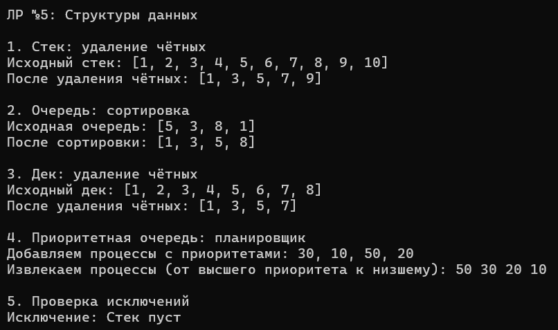

# Лабораторная работа №5. Структуры данных: Стек, Очередь, Дек, Приоритетная очередь

**Студент:** Гуртуев Идар Алиевич

**Группа:** ПИЖ-б-о-25-1

**Вариант:** 7 — Симуляция планировщика задач, удаление чётных из стека/дека, сортировка очереди

**Технология:** C++

**Репозиторий:** https://github.com/idarr1/Cpp-development

---

## 1. Цель работы

Освоить реализацию базовых структур данных: стека (LIFO), очереди (FIFO), дека (двусторонняя очередь) и приоритетной очереди (на основе кучи). Научиться решать прикладные задачи с их помощью.

---

## 2. Теоретическое обоснование

- **Стек (LIFO):** последним пришёл — первым ушёл. Операции `push`, `pop`, `top` — O(1). Аналогия: стопка тарелок.
- **Очередь (FIFO):** первым пришёл — первым ушёл. Реализована на кольцевом буфере. Операции `enqueue`, `dequeue` — O(1). Аналогия: очередь в магазине.
- **Дек (Deque):** добавление и удаление с обоих концов. Реализован на двусвязном списке. Операции с обоих концов — O(1).
- **Приоритетная очередь:** извлекается элемент с наибольшим приоритетом. Реализована на Max-Heap. `push` и `pop` — O(log n), `top` — O(1).

---

## 3. Постановка задачи (Вариант 7)

1. **Стек:** удалить все чётные элементы.
2. **Очередь:** сортировать очередь (с использованием дополнительной очереди).
3. **Дек:** удалить все чётные элементы.
4. **Приоритетная очередь:** симуляция планировщика задач (процессы с разными приоритетами).

---

## 4. Разбор ключевых фрагментов кода

### 4.1. Стек: удаление чётных

```cpp
void removeEven() {
    Stack<T> temp;
    while (!isEmpty()) {
        T val = pop();
        if (val % 2 != 0) temp.push(val); // Оставляем нечётные
    }
    while (!temp.isEmpty()) push(temp.pop());
}
```

**Что делает:** перекладывает элементы в `temp`, сохраняя только нечётные. Затем возвращает их обратно. У стека нет доступа к середине, поэтому используется вспомогательный стек.

**Сложность:** O(n).

### 4.2. Очередь: сортировка

```cpp
void sortQueue() {
    vector<T> vec;
    while (!isEmpty()) vec.push_back(dequeue());
    for (size_t i = 0; i < vec.size(); i++)
        for (size_t j = i + 1; j < vec.size(); j++)
            if (vec[i] > vec[j]) swap(vec[i], vec[j]);
    for (const T& val : vec) enqueue(val);
}
```

**Что делает:** переливает очередь в `vector`, сортирует пузырьком, возвращает обратно.

**Сложность:** O(n²) — сортировка пузырьком.

### 4.3. Дек: удаление чётных

```cpp
void removeEven() {
    Deque<T> temp;
    while (!isEmpty()) {
        T val = pop_front();
        if (val % 2 != 0) temp.push_back(val);
    }
    while (!temp.isEmpty()) push_back(temp.pop_front());
}
```

**Что делает:** то же самое, что и для стека, но через дек (используя `pop_front`/`push_back`).

**Сложность:** O(n).

### 4.4. Приоритетная очередь: Max-Heap

```cpp
void heapifyUp(int index) {
    while (index > 0) {
        int parent = (index - 1) / 2;
        if (heap[index] > heap[parent]) {
            swap(heap[index], heap[parent]);
            index = parent;
        } else break;
    }
}
```

**Что делает:** «всплывает» новый элемент вверх, если он больше родителя. Применяется при `push`. Восстанавливает свойство кучи.

**Сложность:** O(log n).

### 4.5. Обработка исключений

```cpp
T pop() {
    if (isEmpty()) throw underflow_error("Стек пуст");
    return data[topIndex--];
}
```

**Что делает:** если структура пуста — выбрасывает `underflow_error`. В `main` это перехватывается через `try/catch`. Программа не падает.

---

## 5. Анализ сложности

| Структура | Операция | Сложность |
|-----------|----------|-----------|
| Стек | `push`, `pop`, `top` | **O(1)** |
| Стек | `removeEven` | **O(n)** |
| Очередь | `enqueue`, `dequeue`, `front` | **O(1)** |
| Очередь | `sortQueue` | **O(n²)** |
| Дек | `push_front`, `push_back`, `pop_front`, `pop_back` | **O(1)** |
| Дек | `removeEven` | **O(n)** |
| Приоритетная очередь | `push`, `pop` | **O(log n)** |
| Приоритетная очередь | `top` | **O(1)** |

---

## 6. Результаты работы

**Рисунок 1 — Демонстрация всех структур данных**



На скриншоте видно:
- Удаление чётных из стека → `[1, 3, 5, 7, 9]`.
- Сортировка очереди → `[1, 3, 5, 8]`.
- Удаление чётных из дека → `[1, 3, 5, 7]`.
- Извлечение из приоритетной очереди → `50 30 20 10`.
- Перехват исключения при `pop` из пустого стека.

---

## 7. Ответы на контрольные вопросы

### 1. В чём заключается принцип работы стека (LIFO)?
Last In, First Out — последний добавленный элемент извлекается первым. Как стопка тарелок.

### 2. В чём заключается принцип работы очереди (FIFO)?
First In, First Out — первый добавленный элемент извлекается первым. Как очередь в магазине.

### 3. Чем дек отличается от обычной очереди?
Дек позволяет добавлять и удалять элементы с **обоих концов**, а не только с начала и конца.

### 4. Что такое приоритетная очередь? Где она применяется?
Структура, где элементы извлекаются по приоритету. Применяется в планировщиках задач, алгоритмах Дейкстры, обработке событий.

### 5. Как реализовать стек на основе динамического массива?
Через массив с индексом `topIndex` (указывает на вершину). При `push` — `data[++topIndex] = value`. При `pop` — `return data[topIndex--]`.

### 6. Как реализовать очередь на основе кольцевого буфера?
Через массив с индексами `front` и `rear`. `rear = (rear + 1) % capacity`. При переполнении — расширение.

### 7. Почему приоритетную очередь обычно реализуют на куче?
Куча обеспечивает **O(log n)** для вставки и извлечения, и **O(1)** для просмотра максимума. Это оптимально.

### 8. Какова сложность операций push и pop в стеке?
**O(1)** — не зависят от количества элементов.

### 9. Какова сложность операций enqueue и dequeue в очереди?
**O(1)** — с кольцевым буфером.

### 10. Какова сложность операций в приоритетной очереди? Почему?
`push` и `pop` — **O(log n)**, потому что нужно поднимать/опускать элемент по высоте кучи. `top` — **O(1)**.

### 11. Как проверить правильность расстановки скобок с помощью стека?
Проходим по строке: если открывающая — `push`. Если закрывающая — `pop` и проверяем, что пара совпадает. В конце стек должен быть пуст.

### 12. Как реализовать очередь на двух стеках? Какова сложность?
Один стек — для `enqueue` (входной), второй — для `dequeue` (выходной). При `dequeue` перекладываем из входного в выходной. **Амортизированно O(1)**.

### 13. Как реализовать дек на основе двусвязного списка?
Узлы с `prev` и `next`, `head` и `tail`. `push_front` — перед `head`, `push_back` — после `tail`. Все операции **O(1)**.

### 14. Как реализовать дек на основе кольцевого буфера?
Массив с индексами `front` и `back`. `push_front` — `front = (front - 1 + capacity) % capacity`. `push_back` — `back = (back + 1) % capacity`.

### 15. Как реализовать стек с поддержкой получения минимума за O(1)?
Использовать **два стека**: один для данных, второй для минимумов. При `push` — если новый элемент меньше текущего минимума, добавляем его в стек минимумов. `pop` — если удалённый элемент совпадает с минимумом, удаляем и из стека минимумов.

---

## 8. Вывод

В ходе лабораторной работы реализованы четыре структуры данных: стек, очередь (на кольцевом буфере), дек (на двусвязном списке) и приоритетная очередь (на Max-Heap).

Решены задачи варианта 7: удаление чётных элементов из стека и дека, сортировка очереди, симуляция планировщика задач.

Реализована обработка исключений (`underflow_error` при попытке извлечь из пустой структуры). Проведён анализ сложности: операции с концов — O(1), в приоритетной очереди — O(log n).

Получены навыки работы с основными структурами данных и их применения для решения практических задач.

---

## 9. Список использованных источников

1. cppreference: https://en.cppreference.com/
2. Стек, очередь, дек: https://metanit.com/cpp/tutorial/7.6.php
3. Приоритетная очередь: https://en.cppreference.com/w/cpp/container/priority_queue