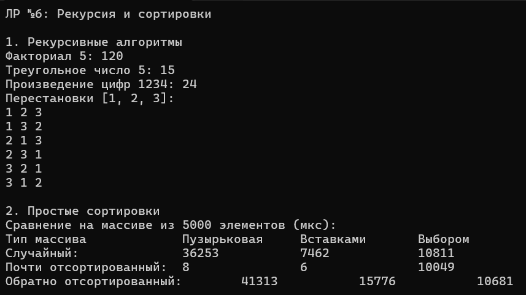

# Лабораторная работа №6. Рекурсивные алгоритмы. Простые сортировки

**Студент:** Гуртуев Идар Алиевич

**Группа:** ПИЖ-б-о-25-1

**Вариант:** 7 — Рекурсия + сравнение сортировок для разных типов данных

**Технология:** C++

**Репозиторий:** https://github.com/idarr1/Cpp-development

---

## 1. Цель работы

Освоить принципы рекурсии (базовый случай и шаг рекурсии). Научиться применять рекурсию для решения практических задач. Реализовать и сравнить простые алгоритмы сортировки: пузырьковую, вставками, выбором. Проанализировать их сложность и производительность на разных типах данных.

---

## 2. Теоретическое обоснование

**Рекурсия** — метод программирования, при котором функция вызывает саму себя. Состоит из двух частей:
- **Базовый случай** — условие остановки (например, `if (n == 0) return 1;`).
- **Шаг рекурсии** — вызов функции с меньшим параметром (например, `return n * factorial(n - 1);`).

Без базового случая возникает **бесконечная рекурсия** и переполнение стека.

**Простые сортировки:**

| Алгоритм | Лучший | Средний | Худший | Память | Устойчивость |
|----------|--------|---------|--------|--------|--------------|
| Пузырьковая | O(n) | O(n²) | O(n²) | O(1) | Да |
| Вставками | O(n) | O(n²) | O(n²) | O(1) | Да |
| Выбором | O(n²) | O(n²) | O(n²) | O(1) | Нет |

---

## 3. Постановка задачи (Вариант 7)

**Часть 1. Рекурсивные алгоритмы:**
1. Факториал числа.
2. Треугольные числа (Tₙ = 1 + 2 + ... + n).
3. Произведение цифр числа.
4. Перебор всех перестановок.

**Часть 2. Простые сортировки:**
- Реализовать пузырьковую сортировку, сортировку вставками, сортировку выбором.
- **Дополнительно:** определить лучшую сортировку для разных типов данных (случайный, почти отсортированный, обратно отсортированный).

---

## 4. Разбор ключевых фрагментов кода

### 4.1. Факториал (рекурсия)

```cpp
long long factorial(int n) {
    if (n <= 1) return 1;        // Базовый случай
    return n * factorial(n - 1); // Шаг рекурсии
}
```

**Что делает:** вычисляет `n!`. Пример: `factorial(5)` → `5 * 4 * 3 * 2 * 1 = 120`.
**Сложность:** O(n).

### 4.2. Треугольное число (рекурсия)

```cpp
int triangular(int n) {
    if (n == 1) return 1;
    return n + triangular(n - 1);
}
```

**Что делает:** `Tₙ = n + (n-1) + ... + 1`. Пример: `triangular(5) = 15`.
**Сложность:** O(n).

### 4.3. Произведение цифр (рекурсия)

```cpp
int productOfDigits(int n) {
    if (n < 10) return n;
    return (n % 10) * productOfDigits(n / 10);
}
```

**Что делает:** перемножает все цифры. Пример: `1234` → `4 * 3 * 2 * 1 = 24`.
**Сложность:** O(log n) — количество цифр.

### 4.4. Перебор перестановок (backtracking)

```cpp
void generatePermutations(vector<int>& arr, int start, int end) {
    if (start == end) { /* вывод */ return; }
    for (int i = start; i <= end; i++) {
        swap(arr[start], arr[i]);
        generatePermutations(arr, start + 1, end);
        swap(arr[start], arr[i]); // backtracking
    }
}
```

**Что делает:** выводит все перестановки массива. Для `[1, 2, 3]` — `123, 132, 213, 231, 312, 321`.
**Сложность:** O(n!).

### 4.5. Пузырьковая сортировка

```cpp
void bubbleSort(int arr[], int n) {
    for (int i = 0; i < n - 1; i++) {
        bool swapped = false;
        for (int j = 0; j < n - i - 1; j++) {
            if (arr[j] > arr[j + 1]) {
                swap(arr[j], arr[j + 1]);
                swapped = true;
            }
        }
        if (!swapped) break; // Оптимизация
    }
}
```

**Сложность:** O(n²) в среднем, **O(n)** на уже отсортированном (благодаря `swapped`).

### 4.6. Сортировка вставками

```cpp
void insertionSort(int arr[], int n) {
    for (int i = 1; i < n; i++) {
        int key = arr[i];
        int j = i - 1;
        while (j >= 0 && arr[j] > key) {
            arr[j + 1] = arr[j];
            j--;
        }
        arr[j + 1] = key;
    }
}
```

**Сложность:** O(n²) в среднем, **O(n)** на почти отсортированном.

### 4.7. Сортировка выбором

```cpp
void selectionSort(int arr[], int n) {
    for (int i = 0; i < n - 1; i++) {
        int minIndex = i;
        for (int j = i + 1; j < n; j++)
            if (arr[j] < arr[minIndex]) minIndex = j;
        if (minIndex != i) swap(arr[i], arr[minIndex]);
    }
}
```

**Сложность:** всегда **O(n²)**.

---

## 5. Результаты работы

**Рисунок 1 — Результаты рекурсивных задач и сравнение сортировок**



На скриншоте видно:
- Результаты всех 4 рекурсивных алгоритмов.
- Перестановки `[1, 2, 3]`.
- Сравнение трёх сортировок на трёх типах массивов (случайный, почти отсортированный, обратно отсортированный).

---

## 6. Сравнительная таблица сортировок

| Тип данных | Пузырьковая | Вставками | Выбором |
|------------|-------------|-----------|---------|
| Случайный | O(n²) | O(n²) | O(n²) |
| Почти отсортированный | **O(n)** | **O(n)** | O(n²) |
| Обратно отсортированный | O(n²) | O(n²) | O(n²) |

**Вывод:** пузырьковая и вставками работают за O(n) на почти отсортированных данных. Выбором — всегда O(n²). Для почти отсортированных данных лучше всего подходят **вставки** (меньше обменов).

---

## 7. Ответы на контрольные вопросы

### 1. Что такое рекурсия? Из каких компонентов состоит рекурсивная функция?
Рекурсия — вызов функции самой себя. Состоит из **базового случая** (остановка) и **шага рекурсии** (вызов с меньшим параметром).

### 2. Что такое базовый случай рекурсии? Почему он важен?
Условие остановки рекурсии. Без него — бесконечная рекурсия и переполнение стека (stack overflow).

### 3. Чем отличается прямая рекурсия от косвенной?
Прямая: функция вызывает сама себя (`factorial`). Косвенная: `A` вызывает `B`, `B` вызывает `A` (`even`/`odd`).

### 4. Что такое хвостовая рекурсия? В чём её преимущество?
Рекурсивный вызов — последняя операция. Компилятор может оптимизировать её в цикл, экономя стек.

### 5. Какова временная сложность рекурсивного вычисления чисел Фибоначчи? Почему?
**O(2ⁿ)** — каждый вызов порождает два новых, дерево вызовов экспоненциально растёт.

### 6. Как можно оптимизировать рекурсивное вычисление Фибоначчи?
Через **мемоизацию** (кэширование) или итеративную реализацию — получаем **O(n)**.

### 7. В чём отличие рекурсивной реализации от итеративной?
Рекурсивная — элегантнее, но тратит стек. Итеративная — быстрее и экономнее по памяти.

### 8. Какова сложность пузырьковой сортировки? Когда она становится O(n)?
**O(n²)** в среднем. **O(n)** — если массив уже отсортирован (благодаря флагу `swapped`).

### 9. Чем сортировка вставками отличается от сортировки выбором?
Вставками вставляет элемент на правильное место, сдвигая остальные. Выбором ищет минимум и ставит в начало. Вставками лучше на почти отсортированных данных.

### 10. Какая из простых сортировок является устойчивой?
Пузырьковая и вставками. **Устойчивость** — сохранение порядка равных элементов.

### 11. Какая из простых сортировок работает лучше на почти отсортированных данных?
**Вставками** — O(n) благодаря тому, что почти не делает сдвигов.

### 12. Как реализовать пузырьковую сортировку с оптимизацией?
Добавить флаг `swapped`. Если за проход не было обменов — массив отсортирован, выходим досрочно.

### 13. Что такое рекурсивный поиск с возвратом (backtracking)?
Перебор с откатом: пробуем вариант → рекурсия → если не подошло, откатываем и пробуем другой. Пример — перестановки.

### 14. Как рекурсивно обойти лабиринт?
Из текущей клетки пробуем пойти в 4 направления. Если нашли выход — возвращаем `true`. Если стена или тупик — возвращаем `false` (backtracking).

### 15. Какова сложность Ханойских башен? Сколько ходов нужно для n дисков?
**O(2ⁿ)** — экспоненциальная. Для `n` дисков нужно **2ⁿ - 1** ходов.

---

## 8. Вывод

В ходе лабораторной работы освоены принципы рекурсии: базовый случай и шаг рекурсии. Реализованы 4 рекурсивные задачи: факториал, треугольные числа, произведение цифр и перебор перестановок (backtracking).

Реализованы три простые сортировки: пузырьковая, вставками, выбором. Проведено экспериментальное сравнение на трёх типах данных. Выяснено, что на почти отсортированных массивах пузырьковая и вставками работают за **O(n)**, а выбором — всегда **O(n²)**.

Получены навыки рекурсивного программирования, backtracking и анализа сложности алгоритмов.

---

## 9. Список использованных источников

1. cppreference: https://en.cppreference.com/
2. Рекурсия: https://metanit.com/cpp/tutorial/2.21.php
3. Сортировки: https://metanit.com/cpp/tutorial/7.4.php