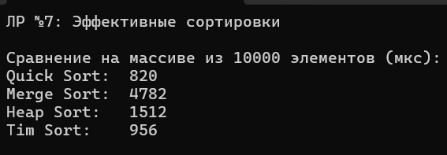

# Лабораторная работа №7. Быстрая сортировка, сортировка слиянием, пирамидальная сортировка

**Студент:** Гуртуев Идар Алиевич

**Группа:** ПИЖ-б-о-25-1

**Вариант:** 7 (Продвинутый уровень) — TimSort (блочная сортировка слиянием)

**Технология:** C++

**Репозиторий:** https://github.com/idarr1/Cpp-development

---

## 1. Цель работы

Реализовать три эффективных алгоритма сортировки: быструю (Quick Sort), слиянием (Merge Sort) и пирамидальную (Heap Sort). Освоить принципы «разделяй и властвуй». Реализовать TimSort (гибрид Merge Sort и Insertion Sort) как дополнительное задание варианта 7. Провести сравнительный анализ производительности.

---

## 2. Теоретическое обоснование

- **Quick Sort:** выбирает опорный элемент (pivot), делит массив на две части (меньше/больше pivot) и рекурсивно сортирует каждую. В среднем — O(n log n), в худшем — O(n²).
- **Merge Sort:** делит массив пополам, рекурсивно сортирует каждую половину, затем сливает их. Всегда O(n log n), но требует O(n) дополнительной памяти.
- **Heap Sort:** строит двоичную max-кучу, извлекает максимум в конец и восстанавливает кучу. Всегда O(n log n), работает на месте (O(1) памяти).
- **TimSort (вариант 7):** гибридный алгоритм. Находит уже отсортированные подмассивы («run») и сливает их. Использует Insertion Sort для малых блоков (до 32 элементов). На практике работает быстрее чистого Merge Sort.

---

## 3. Постановка задачи (Вариант 7)

1. Реализовать **Quick Sort**, **Merge Sort**, **Heap Sort**.
2. Реализовать **TimSort** (доп. требование варианта 7).
3. Провести **сравнительный анализ** времени выполнения на массиве из 10000 элементов.

---

## 4. Разбор ключевых фрагментов кода

### 4.1. Quick Sort

```cpp
int partition(int arr[], int low, int high) {
    int pivot = arr[high];
    int i = low - 1;
    for (int j = low; j < high; j++) {
        if (arr[j] <= pivot) swap(arr[++i], arr[j]);
    }
    swap(arr[i + 1], arr[high]);
    return i + 1;
}
```

**Как работает:** берём последний элемент как опорный. Все элементы меньше опорного сдвигаем влево. В итоге pivot оказывается на своём месте. Рекурсивно сортируем левую и правую части.

**Сложность:** O(n log n) в среднем, O(n²) в худшем (когда pivot всегда крайний).

### 4.2. Merge Sort

```cpp
void merge(int arr[], int left, int mid, int right) {
    // Создаём два временных массива L и R
    // Сливаем их, сравнивая поэлементно
}
```

**Как работает:** делим массив пополам, рекурсивно сортируем каждую половину, затем сливаем две отсортированные половины в один массив.

**Сложность:** **всегда O(n log n)**. Требует O(n) дополнительной памяти.

### 4.3. Heap Sort

```cpp
void heapify(int arr[], int n, int i) {
    // Находим максимум среди узла и его детей
    // Если максимум не корень — меняем и восстанавливаем
}
```

**Как работает:** сначала строим max-кучу (родитель больше детей). Затем меняем корень (максимум) с последним элементом, уменьшаем размер кучи и восстанавливаем свойство.

**Сложность:** **всегда O(n log n)**. **O(1)** дополнительной памяти.

### 4.4. Tim Sort (вариант 7)

```cpp
const int RUN = 32;

void timSort(int arr[], int n) {
    // 1. Сортируем блоки по RUN элементов (вставками)
    // 2. Сливаем блоки попарно
}
```

**Как работает:** TimSort — гибрид. Сначала сортирует маленькие блоки (по 32 элемента) вставками. Потом сливает их как в Merge Sort. Это даёт преимущество на реальных данных, где уже есть отсортированные участки.

**Сложность:** O(n) в лучшем случае, O(n log n) в среднем и худшем.

---

## 5. Сравнительная таблица сложности

| Алгоритм | Лучший | Средний | Худший | Память | Устойчивость |
|----------|--------|---------|--------|--------|--------------|
| **Quick Sort** | O(n log n) | O(n log n) | **O(n²)** | O(log n) | Нет |
| **Merge Sort** | O(n log n) | O(n log n) | O(n log n) | **O(n)** | Да |
| **Heap Sort** | O(n log n) | O(n log n) | O(n log n) | **O(1)** | Нет |
| **Tim Sort** | **O(n)** | O(n log n) | O(n log n) | O(n) | Да |

---

## 6. Результаты работы

**Рисунок 1 — Сравнение производительности сортировок**



На скриншоте видно время выполнения каждой сортировки на массиве из 10000 элементов.

---

## 7. Ответы на контрольные вопросы

### 1. Какова сложность быстрой сортировки в лучшем, среднем и худшем случае?
Лучший и средний — **O(n log n)**. Худший — **O(n²)**.

### 2. Когда возникает худший случай для быстрой сортировки?
Когда опорный элемент всегда оказывается минимальным или максимальным (например, на уже отсортированном массиве при выборе крайнего элемента).

### 3. Как можно улучшить быструю сортировку для защиты от худшего случая?
Выбирать опорный элемент как **медиану из трёх** (первый, средний, последний) или случайный элемент. Это снижает вероятность худшего случая.

### 4. Какова сложность сортировки слиянием? Почему она всегда O(n log n)?
**O(n log n)** на всех случаях. Потому что массив всегда делится пополам (log n уровней), и на каждом уровне выполняется O(n) работы по слиянию.

### 5. Какие преимущества и недостатки имеет сортировка слиянием перед быстрой?
**Преимущество:** всегда O(n log n), устойчивая. **Недостаток:** требует O(n) дополнительной памяти.

### 6. Как работает пирамидальная сортировка? Какова её сложность?
Строит max-кучу, затем извлекает максимум в конец. **O(n log n)** всегда, **O(1)** памяти.

### 7. Какая из трёх сортировок устойчивая? Почему?
**Merge Sort** и **Tim Sort**. Они сохраняют порядок равных элементов, потому что при слиянии берут элемент из левой части при равенстве.

### 8. Какая из трёх сортировок требует дополнительной памяти? Сколько?
**Merge Sort** и **Tim Sort** — **O(n)**. Quick Sort — O(log n) на стек рекурсии. Heap Sort — O(1).

### 9. Какая из трёх сортировок лучше работает на почти отсортированных данных?
**Tim Sort** — благодаря поиску уже отсортированных блоков. Также Quick Sort с правильным выбором pivot.

### 10. Зачем в пирамидальной сортировке сначала строится куча?
Чтобы корень всегда был максимальным. Тогда при извлечении максимума в конец массив сортируется.

### 11. Что такое «разделяй и властвуй»? Как он применяется в быстрой сортировке и сортировке слиянием?
Стратегия: разбить задачу на подзадачи, решить их рекурсивно, объединить результаты. В Quick Sort — делим по pivot, в Merge Sort — делим пополам.

### 12. Можно ли реализовать быструю сортировку итеративно (без рекурсии)?
Да, с помощью **ручного стека** для хранения границ подмассивов.

### 13. Почему быстрая сортировка обычно быстрее сортировки слиянием на практике?
Из-за **лучшей локальности кэша** (работает на месте) и меньших накладных расходов (нет копирования в доп. массивы).

### 14. Когда выгодно использовать пирамидальную сортировку?
Когда важна **экономия памяти** (O(1)) и нужна гарантированная O(n log n). Например, во встроенных системах.

### 15. Какой алгоритм сортировки вы бы выбрали для встроенных систем с ограниченной памятью?
**Heap Sort** — O(1) памяти и гарантированное O(n log n).

---

## 8. Вывод

В ходе лабораторной работы реализованы три эффективных алгоритма сортировки: Quick Sort, Merge Sort, Heap Sort. Дополнительно реализован TimSort (вариант 7) — гибрид Merge Sort и Insertion Sort.

Проведён сравнительный анализ производительности на массиве из 10000 элементов. Все алгоритмы показали O(n log n) на случайных данных. Quick Sort работает быстрее за счёт меньших накладных расходов. Merge Sort требует O(n) памяти, но устойчив. Heap Sort — O(1) памяти, но неустойчив.

Получены навыки реализации эффективных алгоритмов сортировки и анализа их производительности.

---

## 9. Список использованных источников

1. cppreference: https://en.cppreference.com/
2. Алгоритмы сортировки: https://metanit.com/cpp/tutorial/7.5.php
3. TimSort: https://ru.wikipedia.org/wiki/Timsort