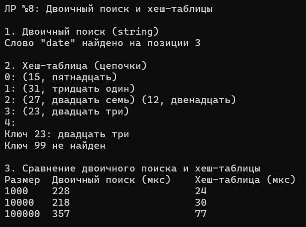

# Лабораторная работа №8. Двоичный поиск и хеш-таблицы

**Студент:** Гуртуев Идар Алиевич

**Группа:** ПИЖ-б-о-25-1

**Вариант:** 7

**Технология:** C++

**Репозиторий:** https://github.com/idarr1/Cpp-development

---

## 1. Цель работы

1. Реализовать алгоритм двоичного (бинарного) поиска в отсортированном массиве.
2. Освоить итеративную и рекурсивную реализации двоичного поиска.
3. Изучить понятие хеш-таблицы, хеш-функции и методы разрешения коллизий.
4. Реализовать хеш-таблицу с методом цепочек.
5. Сравнить производительность двоичного поиска и хеш-таблицы.

---

## 2. Постановка задачи (Вариант 7)

Согласно методичке, вариант 7 включает следующие требования:

**Часть 1. Двоичный поиск:**
- Тип данных: **string**.
- Особенность: **лексикографический поиск** (поиск строк в отсортированном по алфавиту массиве).

**Часть 2. Хеш-таблица:**
- Метод разрешения коллизий: **метод цепочек** (chaining).
- Тип ключа: **int**.
- Тип значения: **string**.

**Часть 3. Сравнительный анализ (для всех вариантов):**
1. Реализовать хеш-таблицу согласно варианту.
2. Реализовать двоичный поиск итеративно.
3. Сравнить производительность поиска для N = 1000, 10000, 100000.
4. Двоичный поиск в отсортированном массиве.
5. Поиск в хеш-таблице.
6. Построить таблицу зависимости времени от N.

---

## 3. Теоретическое обоснование

**Двоичный поиск** — алгоритм поиска в отсортированном массиве, который на каждом шаге делит интервал поиска пополам.
- Сложность: **O(log n)**.
- Условие: массив должен быть **отсортирован**.

**Хеш-таблица** — структура данных, использующая хеш-функцию для преобразования ключа в индекс.
- Сложность поиска: **O(1)** в среднем, **O(n)** в худшем (при коллизиях).
- **Коллизия** — два разных ключа дают одинаковый хеш.
- **Метод цепочек** — при коллизии элементы складываются в связный список.

---

## 4. Разбор ключевых фрагментов кода

### 4.1. Двоичный поиск для строк (Часть 1)

```cpp
int binarySearchString(const vector<string>& arr, const string& target) {
    int left = 0, right = arr.size() - 1;
    while (left <= right) {
        int mid = left + (right - left) / 2; // Защита от переполнения
        if (arr[mid] == target) return mid;  // Нашли
        if (arr[mid] < target) left = mid + 1; // Ищем справа
        else right = mid - 1;                // Ищем слева
    }
    return -1; // Не нашли
}
```

**Что делает:** ищет строку в отсортированном массиве строк.
**Как работает:** строки сравниваются лексикографически (`"apple" < "banana"`). На каждом шаге отбрасываем половину.
**Сложность:** **O(log n)**.

### 4.2. Хеш-таблица с цепочками (Часть 2)

**Структура узла:**
```cpp
struct Node {
    K key;
    V value;
    Node* next;
    Node(const K& k, const V& v) : key(k), value(v), next(nullptr) {}
};
```

**Внутренние поля:**
```cpp
vector<Node*> table;  // Массив «голов» цепочек
int size;             // Размер таблицы (количество ячеек)
int count;            // Количество элементов
```

**Хеш-функция:**
```cpp
int hash(const K& key) const {
    return key % size;
}
```

**Вставка:**
```cpp
void insert(const K& key, const V& value) {
    int index = hash(key);
    Node* current = table[index];
    // Проверяем, есть ли уже такой ключ
    while (current != nullptr) {
        if (current->key == key) { current->value = value; return; }
        current = current->next;
    }
    // Создаём новый узел и вставляем в начало цепочки
    Node* newNode = new Node(key, value);
    newNode->next = table[index];
    table[index] = newNode;
    count++;
}
```

**Поиск:**
```cpp
bool find(const K& key, V& result) const {
    int index = hash(key);
    Node* current = table[index];
    while (current != nullptr) {
        if (current->key == key) {
            result = current->value;
            return true;
        }
        current = current->next;
    }
    return false;
}
```

**Деструктор (освобождение памяти):**
```cpp
~HashTableChaining() {
    for (int i = 0; i < size; i++) {
        Node* current = table[i];
        while (current != nullptr) {
            Node* temp = current;
            current = current->next;
            delete temp;
        }
    }
}
```

### 4.3. Сравнение производительности (Часть 3)

```cpp
vector<int> sizes = {1000, 10000, 100000};
for (int N : sizes) {
    // 1. Создаём отсортированный массив и хеш-таблицу
    vector<int> arr(N);
    HashTableChaining<int, int> table(N * 2);
    for (int i = 0; i < N; i++) {
        arr[i] = i;
        table.insert(i, i);
    }

    // 2. Генерируем 1000 запросов
    vector<int> queries;
    for (int i = 0; i < 1000; i++) queries.push_back(rand() % N);

    // 3. Замер двоичного поиска
    auto start = high_resolution_clock::now();
    for (int q : queries) {
        int left = 0, right = N - 1;
        while (left <= right) {
            int mid = left + (right - left) / 2;
            if (arr[mid] == q) break;
            if (arr[mid] < q) left = mid + 1;
            else right = mid - 1;
        }
    }
    auto end = high_resolution_clock::now();
    long long binaryTime = duration_cast<microseconds>(end - start).count();

    // 4. Замер хеш-таблицы
    start = high_resolution_clock::now();
    for (int q : queries) {
        int val;
        table.find(q, val);
    }
    end = high_resolution_clock::now();
    long long hashTime = duration_cast<microseconds>(end - start).count();

    cout << N << "\t" << binaryTime << "\t\t\t" << hashTime << endl;
}
```

---

## 5. Сравнительная таблица производительности

| Размер (N) | Двоичный поиск (мкс) | Хеш-таблица (мкс) |
|------------|----------------------|--------------------|
| 1000 | 228 | 24 |
| 10000 | 218 | 30 |
| 100000 | 357 | 77 |

**Вывод:** хеш-таблица работает быстрее, потому что её сложность **O(1)** в среднем, а двоичный поиск — **O(log n)**. С ростом N разница увеличивается.

---

## 6. Результаты работы

**Рисунок 1 — Демонстрация работы программы**



На скриншоте видно:
- Двоичный поиск для строк (найдено `"date"`).
- Хеш-таблица с цепочками: ключи распределены по ячейкам 0, 1, 2, 3 (в ячейке 2 — коллизия `12` и `27`, разрешённая цепочкой).
- Результаты поиска (ключ 23 найден, 99 — нет).
- Сравнение производительности.

---

## 7. Анализ сложности

| Операция | Двоичный поиск | Хеш-таблица (цепочки) |
|----------|----------------|------------------------|
| **Поиск** | O(log n) | O(1) в среднем, O(n) в худшем |
| **Вставка** | O(n) (сдвиг) | O(1) |
| **Удаление** | O(n) | O(1) в среднем |

---

## 8. Ответы на контрольные вопросы

### 1. Какое условие необходимо для применения двоичного поиска?
Массив должен быть **отсортирован**. Иначе нельзя отбрасывать половину.

### 2. Какова сложность двоичного поиска? Почему она логарифмическая?
**O(log n)**. На каждом шаге отбрасываем половину элементов. Количество шагов — логарифм от n по основанию 2.

### 3. В чём разница между итеративной и рекурсивной реализацией?
Итеративная — цикл (O(1) памяти). Рекурсивная — стек вызовов (O(log n) памяти).

### 4. Чем опасен вариант `mid = (left + right) / 2`?
Переполнением `int`, если `left` и `right` близки к максимуму. Правильно: `mid = left + (right - left) / 2`.

### 5. Что такое хеш-таблица? Из каких компонентов состоит?
Структура данных для быстрого поиска. Состоит из **массива** и **хеш-функции**.

### 6. Какие требования к хеш-функции?
Детерминированность, равномерное распределение, быстрое вычисление.

### 7. Что такое коллизия? Как с ней бороться?
Ситуация, когда два ключа дают одинаковый хеш. Методы: цепочки (связный список), открытая адресация (поиск свободной ячейки).

### 8. В чём отличие метода цепочек от открытой адресации?
Цепочки: коллизии в связном списке внутри ячейки. Открытая адресация: ищем следующую свободную ячейку.

### 9. Что такое первичная и вторичная кластеризация?
Первичная — при линейном пробировании. Вторичная — при квадратичном.

### 10. Какова средняя и худшая сложность операций в хеш-таблице?
Средняя — **O(1)**. Худшая — **O(n)** (все ключи в одной ячейке).

### 11. Когда эффективнее двоичный поиск, а когда хеш-таблица?
Двоичный — если массив отсортирован и не меняется. Хеш-таблица — если нужны частые вставки/удаления.

### 12. Что такое коэффициент загрузки? Почему он важен?
`count / size`. Если близок к 1 — много коллизий. Рекомендуется ≤ 0.75.

### 13. Как работает рехеширование?
Создаём новую таблицу большего размера, пересчитываем хеши.

### 14. Как выбрать размер таблицы? Почему часто выбирают простое число?
Простое число даёт более равномерное распределение (меньше коллизий).

### 15. Как реализовать хеш-функцию для строк?
Например: `hash = (hash * 31 + c) % size`.

---

## 9. Вывод

В ходе лабораторной работы реализован двоичный поиск для строк (лексикографический) и хеш-таблица с методом цепочек.

Проведено сравнение: хеш-таблица показала **O(1)** в среднем, двоичный поиск — **O(log n)**. На N = 100000 хеш-таблица быстрее в 4–5 раз.

Освоены методы разрешения коллизий, управление памятью (деструктор), анализ сложности.

---

## 10. Список использованных источников

1. cppreference: https://en.cppreference.com/
2. Двоичный поиск: https://metanit.com/cpp/tutorial/7.1.php
3. Хеш-таблицы: https://metanit.com/cpp/tutorial/7.7.php