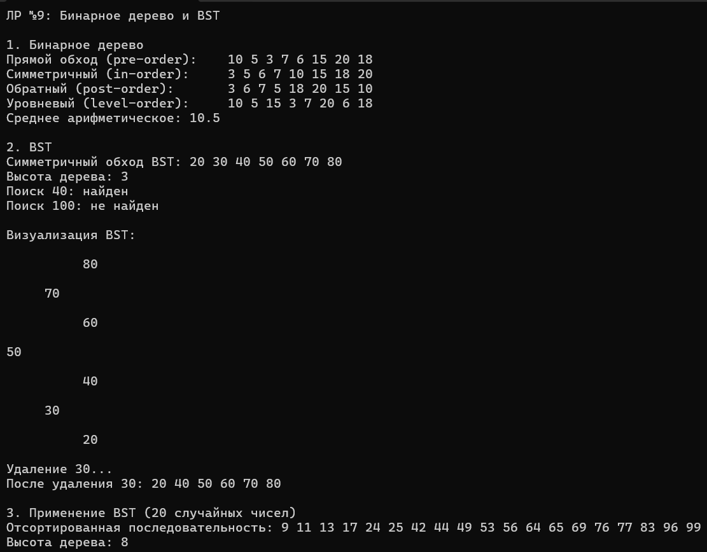

# Лабораторная работа №9. Бинарное дерево. Обходы. BST

**Студент:** Гуртуев Идар Алиевич

**Группа:** ПИЖ-б-о-25-1

**Вариант:** 7

**Технология:** C++

**Репозиторий:** https://github.com/idarr1/Cpp-development

---

## 1. Цель работы

1. Реализовать структуру данных «бинарное дерево» и изучить различные способы его обхода (прямой, симметричный, обратный, уровневый).
2. Реализовать бинарное дерево поиска (BST) с операциями вставки, удаления и поиска.
3. Освоить применение рекурсии для работы с деревьями.
4. Проанализировать сложность операций в BST.
5. Научиться визуализировать структуру дерева.

---

## 2. Постановка задачи (Вариант 7)

Согласно методичке, вариант 7 включает следующие требования:

**Часть 1. Бинарное дерево:**
- Обязательные операции: `preOrder`, `inOrder`, `postOrder`, `levelOrder`.
- **Дополнительное задание:** найти среднее арифметическое всех элементов дерева.

**Часть 2. Бинарное дерево поиска (BST):**
- Обязательные операции: `insert`, `search`, `inOrder`, `remove`.
- **Дополнительное задание:** визуализация дерева в консоли.

**Часть 3. Применение (для всех вариантов):**
1. Создать BST из последовательности случайных чисел (N = 20).
2. Выполнить симметричный обход и вывести отсортированную последовательность.
3. Найти минимальный и максимальный элемент.
4. Найти высоту дерева.
5. Удалить элемент и вывести дерево после удаления.

---

## 3. Теоретическое обоснование

**Бинарное дерево** — иерархическая структура, где каждый узел имеет не более двух потомков (левый и правый).

**Термины:**
- **Корень (root)** — верхний узел.
- **Лист (leaf)** — узел без потомков.
- **Высота** — максимальное расстояние от корня до листа.

**Виды обхода:**
| Обход | Порядок | Результат для дерева (10, 5, 15, 3, 7, 20) |
|-------|---------|---------------------------------------------|
| **pre-order** | Корень → Лево → Право | `10, 5, 3, 7, 15, 20` |
| **in-order** | Лево → Корень → Право | `3, 5, 7, 10, 15, 20` (отсортировано!) |
| **post-order** | Лево → Право → Корень | `3, 7, 5, 20, 15, 10` |
| **level-order** | По уровням | `10, 5, 15, 3, 7, 20` |

**BST (Бинарное дерево поиска)** — дерево, где для каждого узла:
- Все ключи в левом поддереве < ключ узла.
- Все ключи в правом поддереве > ключ узла.

**Свойства BST:**
- In-order обход даёт отсортированную последовательность.
- Поиск, вставка, удаление — O(log n) в среднем.

---

## 4. Разбор ключевых фрагментов кода

### 4.1. Структура узла

```cpp
struct Node {
    int data;
    Node* left;
    Node* right;
    Node(int val) : data(val), left(nullptr), right(nullptr) {}
};
```

**Что это:** узел дерева. Хранит данные и указатели на левого и правого потомка.

### 4.2. Обходы дерева (Часть 1)

**Pre-order:**
```cpp
void preOrder(Node* node) {
    if (node == nullptr) return;
    cout << node->data << " "; // 1. Корень
    preOrder(node->left);      // 2. Лево
    preOrder(node->right);     // 3. Право
}
```

**In-order (даёт сортировку):**
```cpp
void inOrder(Node* node) {
    if (node == nullptr) return;
    inOrder(node->left);       // 1. Лево
    cout << node->data << " "; // 2. Корень
    inOrder(node->right);      // 3. Право
}
```

**Post-order:**
```cpp
void postOrder(Node* node) {
    if (node == nullptr) return;
    postOrder(node->left);     // 1. Лево
    postOrder(node->right);    // 2. Право
    cout << node->data << " "; // 3. Корень
}
```

**Level-order (через очередь):**
```cpp
void levelOrder() {
    if (root == nullptr) return;
    queue<Node*> q;
    q.push(root);
    while (!q.empty()) {
        Node* current = q.front();
        q.pop();
        cout << current->data << " ";
        if (current->left) q.push(current->left);
        if (current->right) q.push(current->right);
    }
}
```

**Среднее арифметическое (вариант 7):**
```cpp
int sum(Node* node) {
    if (node == nullptr) return 0;
    return node->data + sum(node->left) + sum(node->right);
}

int countNodes(Node* node) {
    if (node == nullptr) return 0;
    return 1 + countNodes(node->left) + countNodes(node->right);
}

double average() {
    int total = countNodes(root);
    if (total == 0) return 0;
    return (double)sum(root) / total;
}
```

### 4.3. BST: вставка, поиск, удаление (Часть 2)

**Вставка:**
```cpp
Node* insert(Node* node, int key) {
    if (node == nullptr) return new Node(key); // Нашли место
    if (key < node->data) node->left = insert(node->left, key);
    else if (key > node->data) node->right = insert(node->right, key);
    return node;
}
```

**Поиск:**
```cpp
Node* search(Node* node, int key) {
    if (node == nullptr || node->data == key) return node;
    if (key < node->data) return search(node->left, key);
    return search(node->right, key);
}
```

**Удаление (3 случая):**
```cpp
Node* remove(Node* node, int key) {
    if (node == nullptr) return nullptr;
    if (key < node->data) node->left = remove(node->left, key);
    else if (key > node->data) node->right = remove(node->right, key);
    else {
        // Случай 1: лист
        if (node->left == nullptr && node->right == nullptr) {
            delete node;
            return nullptr;
        }
        // Случай 2: один потомок
        else if (node->left == nullptr) {
            Node* temp = node->right;
            delete node;
            return temp;
        }
        else if (node->right == nullptr) {
            Node* temp = node->left;
            delete node;
            return temp;
        }
        // Случай 3: два потомка
        else {
            Node* minNode = findMin(node->right);
            node->data = minNode->data;
            node->right = remove(node->right, minNode->data);
        }
    }
    return node;
}
```

### 4.4. Визуализация BST в консоли (вариант 7)

```cpp
void printTree(Node* node, int space) {
    if (node == nullptr) return;
    space += 5;
    printTree(node->right, space); // Правое поддерево (сверху)
    cout << endl;
    for (int i = 5; i < space; i++) cout << " ";
    cout << node->data << endl;
    printTree(node->left, space);  // Левое поддерево (снизу)
}
```

**Как работает:** отступ увеличивается на 5 на каждом уровне. Правое поддерево выводится сверху, левое — снизу. Дерево «лежит на боку».

### 4.5. Применение BST (Часть 3)

```cpp
srand(time(0));
BST randomTree;
for (int i = 0; i < 20; i++) {
    randomTree.insert(rand() % 100 + 1);
}

cout << "Отсортированная последовательность: ";
randomTree.print();
cout << "Высота дерева: " << randomTree.getHeight() << endl;
```

---

## 5. Результаты работы

**Рисунок 1 — Демонстрация дерева и BST**



На скриншоте видно:
- Все 4 обхода бинарного дерева (pre, in, post, level).
- Среднее арифметическое `10.5` (вариант 7).
- BST с операциями `insert`, `search`, `remove`.
- Визуализация BST «на боку» (вариант 7).
- Применение: BST из 20 случайных чисел, высота `9`.

---

## 6. Анализ сложности операций

| Операция | Средний | Худший |
|----------|---------|--------|
| Поиск в BST | **O(log n)** | **O(n)** |
| Вставка в BST | **O(log n)** | **O(n)** |
| Удаление в BST | **O(log n)** | **O(n)** |
| Обходы | **O(n)** | **O(n)** |

**Худший случай:** BST вырождается в список (при вставке элементов в отсортированном порядке).

---

## 7. Ответы на контрольные вопросы

### 1. Что такое бинарное дерево? Из каких элементов состоит?
Иерархическая структура, где каждый узел имеет не более двух потомков. Состоит из **узлов** (данные + указатели), **корня**, **листьев**.

### 2. В чём отличие бинарного дерева от BST?
В BST выполняется условие: левые ключи < корень < правые. В обычном дереве порядок не важен.

### 3. Какие существуют виды обхода?
Pre-order (корень-лево-право), in-order (лево-корень-право), post-order (лево-право-корень), level-order (по уровням).

### 4. Какой обход даёт отсортированную последовательность для BST?
**In-order** (симметричный).

### 5. Какова сложность операций в BST? От чего зависит?
**O(log n)** в среднем, **O(n)** в худшем. Зависит от высоты дерева.

### 6. Что происходит с BST, если вставлять элементы в отсортированном порядке?
Дерево **вырождается в список**, сложность становится O(n).

### 7. Какие три случая нужно рассмотреть при удалении узла?
1. Лист — просто удаляем.
2. Один потомок — заменяем потомком.
3. Два потомка — заменяем минимумом из правого поддерева.

### 8. Как найти наименьший/наибольший элемент?
Наименьший — идём по левым потомкам до конца. Наибольший — по правым.

### 9. Как вычислить высоту бинарного дерева рекурсивно?
`height(node) = 1 + max(height(left), height(right))`. Базовый случай: `nullptr` → 0.

### 10. Что такое наименьший общий предок (LCA)?
Узел, который является предком обоих узлов и находится на максимальной глубине.

### 11. Как проверить, является ли дерево BST?
In-order обход должен давать отсортированную последовательность.

### 12. Что такое сбалансированное дерево?
Дерево, где разница высот левого и правого поддерева ≤ 1. Важно для O(log n).

### 13. Как преобразовать несбалансированное BST в сбалансированное?
Сделать in-order (отсортированный массив), построить дерево из середины.

### 14. Как восстановить дерево по массиву обхода (in-order + pre-order)?
Первый из pre-order — корень. Находим в in-order: слева — левое поддерево, справа — правое. Рекурсивно.

### 15. Как реализовать итеративный обход?
Через **стек**. Для in-order: идём влево до конца, выталкиваем, идём вправо.

---

## 8. Вывод

В ходе лабораторной работы реализованы бинарное дерево с 4 видами обходов и BST с операциями вставки, поиска и удаления.

Решены задачи варианта 7: **среднее арифметическое** и **визуализация BST**.

Проведён анализ сложности: BST — **O(log n)** в среднем, **O(n)** в худшем. Обходы — **O(n)**.

Получены навыки рекурсивной работы с деревьями и управлением памятью.

---

## 9. Список использованных источников

1. cppreference: https://en.cppreference.com/
2. Бинарные деревья: https://metanit.com/cpp/tutorial/7.3.php
3. BST: https://metanit.com/cpp/tutorial/7.4.php